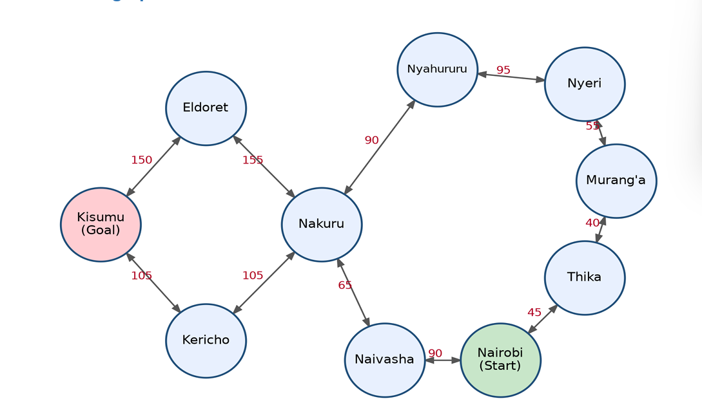
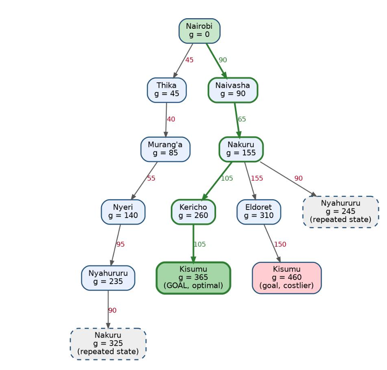

## 1. Agent Design (PEAS Framework)

The agent is a self-driving trailer that must haul cargo along Kenya's highway network from Nairobi to Kisumu.

| Component | Description |
|---|---|
| **Performance measure** | Shortest total distance (and hence time and fuel), safe arrival, cargo delivered intact, compliance with traffic rules, low operating cost. |
| **Environment** | Kenyan highways and roads, towns and cities, other vehicles, pedestrians, animals, weather, road conditions, traffic, weighbridges and checkpoints. |
| **Actuators** | Steering, accelerator, brakes, gear system, indicators, headlights, horn, in-cab display/alerts. |
| **Sensors** | GPS, cameras, radar/lidar, speedometer, odometer, fuel gauge, load sensor, tyre-pressure sensors, microphone. |

### Environment definition

| Property | Classification | Justification |
|---|---|---|
| Observability | Partially observable | Sensors cannot see around bends, hidden road damage, or other drivers' intentions. |
| Number of agents | Multi-agent | Other drivers, pedestrians and vehicles also act in the environment (competitive and cooperative). |
| Determinism vs Stochastic | Stochastic | Breakdowns, accidents, weather and traffic make the outcome of an action uncertain. |
| Episodic vs sequential | Sequential | Each decision (e.g. which road to take) affects later decisions and the final outcome. |
| Static vs dynamic | Dynamic | The environment changes while the agent is deliberating (traffic, weather). |
| Discrete vs continuous | Continuous | Speed, position and time are continuous. The abstracted route graph used for planning is discrete. |

---

## 2. Directed Graph and Search Tree

### Abstraction

The real road network is far too detailed to search directly. The map is abstracted so that only information relevant to route choice is kept:

- **Kept:** towns/cities as nodes (states); highway links between them as edges (actions); road distance in km as edge weight (step cost).
- **Removed:** minor junctions, villages, lane details, traffic, weather, road quality and elevation.
- Each two-way highway is modelled as two directed edges with equal cost, one in each direction.

### Problem formulation

| Element | Definition |
|---|---|
| **States** | The town the trailer is currently in. |
| **Initial state** | Nairobi |
| **Goal test** | Is the current town Kisumu? |
| **Actions** | Drive along a highway to an adjacent town. |
| **Path cost** | Sum of road distances (km) along the route. |

### Directed graph

*Figure 1: Abstracted highway network (each link is two directed edges; labels are distances in km).*

| Link (both directions) | Distance (km) |
|---|---|
| Nairobi <-> Thika | 45 |
| Nairobi <-> Naivasha | 90 |
| Thika <-> Murang'a | 40 |
| Murang'a <-> Nyeri | 55 |
| Nyeri <-> Nyahururu | 95 |
| Nyahururu <-> Nakuru | 90 |
| Naivasha <-> Nakuru | 65 |
| Nakuru <-> Kericho | 105 |
| Nakuru <-> Eldoret | 155 |
| Kericho <-> Kisumu | 105 |
| Eldoret <-> Kisumu | 150 |
 
*Distances are approximate road distances between towns.*

### Search tree

Root = Nairobi (initial state). Each node shows the cumulative path cost g(n). Branches that would return to a town already on the same path are pruned; dashed grey nodes are repeated states reached at a higher cost than an earlier visit, so they are not expanded further.

*Figure 2: Search tree from Nairobi to Kisumu. The optimal path is highlighted in green (thick arrows).*

---

## 3. Optimal Path (Uniform-Cost Search)

With distance between towns as the path cost function g(n), Uniform-Cost Search always expands the frontier node with the lowest cumulative cost, so the first time the goal is removed from the frontier its path is optimal.

| Step | Expand (cost) | Added to frontier |
|---|---|---|
| 1 | Nairobi (0) | Thika 45, Naivasha 90 |
| 2 | Thika (45) | Murang'a 85 |
| 3 | Murang'a (85) | Nyeri 140 |
| 4 | Naivasha (90) | Nakuru 155 |
| 5 | Nyeri (140) | Nyahururu 235 |
| 6 | Nakuru (155) | Kericho 260, Eldoret 310 (Nyahururu via Nakuru = 245, worse than 235, ignored) |
| 7 | Nyahururu (235) | Nakuru via Nyahururu = 325, worse than 155, ignored |
| 8 | Kericho (260) | Kisumu 365 |
| 9 | Eldoret (310) | Kisumu via Eldoret = 460, worse than 365, ignored |
| 10 | Kisumu (365) | Goal reached |

### Result

**Optimal path:** Nairobi → Naivasha → Nakuru → Kericho → Kisumu

**Total distance:** 90 + 65 + 105 + 105 = **365 km**

The alternative via Eldoret costs 90 + 65 + 155 + 150 = 460 km, and the route through Thika, Murang'a, Nyeri and Nyahururu is far longer, so the Kericho route is the least-cost path.
